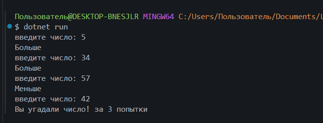
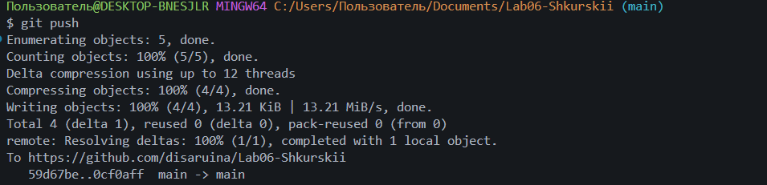

# Практическая работа №6
**ФИО:** Шкурский Максим Витальевич
**Группа:** ИСП-242
**Дата:** 03.11.2026

## Что изучено
- Научился использовать циклы `for` (когда количество шагов известно заранее) и `while` / `do while` (когда нужно повторять код по условию).
- Понял разницу между `while` и `do while`: первый проверяет условие сразу, а второй сначала гарантированно выполняет код хотя бы один раз.
- Разобрался, как с помощью оператора `break` досрочно останавливать циклы и как с помощью `continue` пропускать ненужные шаги.

## Структура проекта
- `Program.cs` — один файл, содержащий последовательно закомментированные решения всех заданий и итоговую игру.
- `img/` — папка со скриншотами работы программы.

## Блок кода (Игра "Угадай число")
Пример реализации игрового цикла с ограничением попыток и проверкой условий:
```csharp
int c = 0;
int secr = 42;
int pop = 0;
while (pop < 5)
{
    Console.Write("введите число: ");
    c = Convert.ToInt32(Console.ReadLine());
    if (c == 42)
    {
        Console.WriteLine($"Вы угадали число! за {pop} попытки");
        break;
    }
    else
    {
        if (c < secr)
        {
            Console.WriteLine("Больше");
            pop++;
        }
        else if (c > secr)
        {
            Console.WriteLine("Меньше");
            pop++;
        }
    }
}
if (pop == 5)
{
    Console.WriteLine("вы проиграли число было 42");
}
```

## Скриншоты


